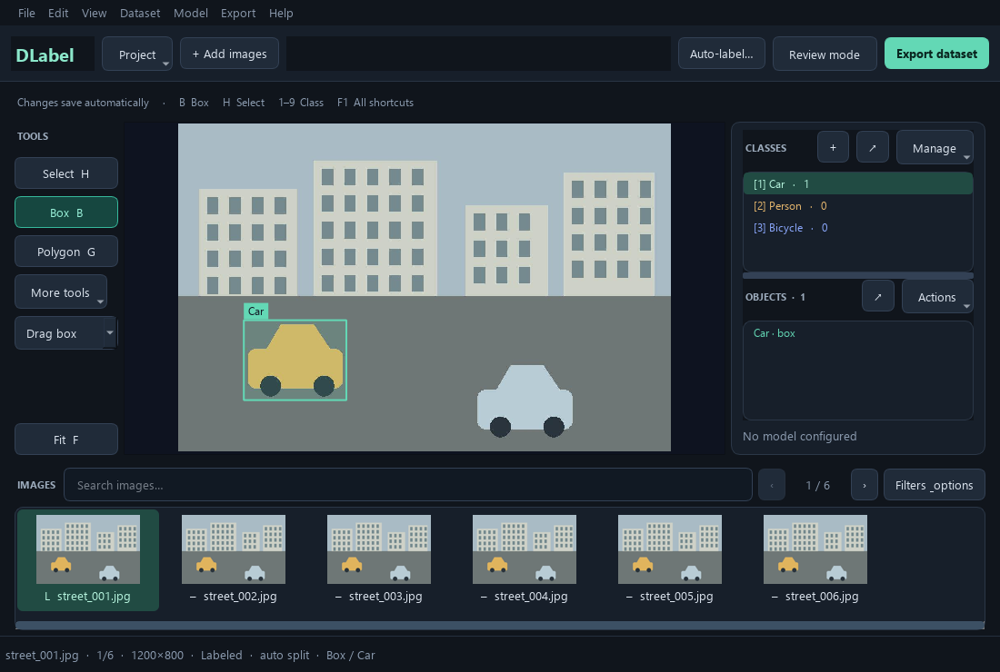

# DLabel — Label Tool

แอปเดสก์ท็อปสำหรับทำ Annotation รูปภาพและเตรียม Dataset สำหรับ YOLO รองรับ Box, Point, Polygon และ Keypoint พร้อม Auto-label ตรวจผลทำนาย Export และ Training ในเครื่อง

คู่มือนี้ใช้ **Windows / PowerShell** ชื่อปุ่มและเมนูตรงกับหน้าจอภาษาอังกฤษของโปรแกรม



## สารบัญ

- [ความสามารถ](#features)
- [ติดตั้งและเปิดโปรแกรม](#install)
- [เริ่มทำ Dataset แรก](#quickstart)
- [รู้จักหน้าจอ](#interface)
- [Classes และ Objects](#classes-objects)
- [วาดและแก้ไข Annotation](#annotation)
- [ค้นหาและกรองรูป](#filters)
- [Auto-label ด้วยโมเดล](#auto-label)
- [Auto-label จากข้อความ](#text-prompt)
- [ตรวจและอนุมัติผล](#review)
- [นำเข้า Dataset และวิดีโอ](#import)
- [ส่งออก Dataset](#export)
- [เทรนโมเดล](#training)
- [คีย์ลัด](#shortcuts)
- [สำรองและย้ายงาน](#backup)
- [แก้ปัญหาที่พบบ่อย](#troubleshooting)
- [โครงสร้างโค้ดและการทดสอบ](#development)
- [อัปขึ้น GitHub](#github)
- [ข้อจำกัด](#limitations)

<a id="features"></a>
## ความสามารถ

- บันทึก Annotation อัตโนมัติในโปรเจกต์ `.dlabel` ด้วย SQLite และเปิดทำงานต่อได้
- วาดกรอบ Box, จุดอิสระ Point, Polygon และ Keypoint ที่ผูกกับ Box
- จัดการ Class พร้อมสี คีย์ลัด การเรียงลำดับ และการรวมคลาส
- Undo / Redo, Copy / Paste และคัดลอก Label จากรูปก่อนหน้า
- ใช้ YOLO หรือคำค้นผ่าน YOLO-World ช่วยสร้างกรอบ แล้วตรวจผลก่อนใช้งาน
- นำเข้า YOLO Dataset และดึงเฟรมวิดีโอในเครื่อง
- Export Detect / Seg / Pose ตามโปรไฟล์ พร้อมแบ่ง Train / Validation / Test และสร้าง ZIP
- เทรนโมเดล Detect แล้วนำ `best.pt` กลับมาใช้ Auto-label
- Classes / Objects เปิดแยกเป็นหน้าต่างที่ขยายได้ และ Thumbnail โหลดเบื้องหลัง

<a id="install"></a>
## ติดตั้งและเปิดโปรแกรม

### สิ่งที่ต้องเตรียม

| รายการ | รายละเอียด |
| --- | --- |
| ระบบตามคู่มือ | Windows พร้อม PowerShell |
| Python | 3.10 ขึ้นไป พร้อม pip และ venv |
| Git | สำหรับ Clone / Push; ดาวน์โหลด ZIP แทนได้ |
| อินเทอร์เน็ต | สำหรับติดตั้งแพ็กเกจและดาวน์โหลดโมเดล/ตัวอ่านคำค้นครั้งแรก |
| GPU | ไม่จำเป็นสำหรับวาด Label; Auto-label และ Training ใช้ CPU ได้ |

การใช้ GPU ต้องเตรียม PyTorch / CUDA ให้รองรับอุปกรณ์ก่อน การเลือก Device `0` ไม่ได้ติดตั้งส่วนรองรับ GPU ให้อัตโนมัติ

### 1. ดาวน์โหลดโปรเจกต์

ดาวน์โหลด ZIP จาก Repository แล้วแตกไฟล์ หรือ Clone โดยแทน URL ตัวอย่างด้วย Repository จริง:

```powershell
git clone https://github.com/YOUR_USERNAME/YOUR_REPOSITORY.git
cd YOUR_REPOSITORY
```

หากใช้ ZIP ให้เปิด PowerShell ในโฟลเดอร์ที่มี `label_tool.py` คำสั่งต่อจากนี้ต้องรันจากโฟลเดอร์นั้น

### 2. สร้าง Virtual Environment

```powershell
python --version
python -m venv .venv
.\.venv\Scripts\python.exe -m pip install --upgrade pip
```

หาก `python` เปิด Microsoft Store หรือหาไม่พบ ให้ตรวจการติดตั้งและ PATH หากเครื่องมี Python Launcher ใช้ `py -3 -m venv .venv` แทนคำสั่งสร้าง Environment ได้

คู่มือนี้เรียก Python ใน `.venv` โดยตรง ไม่ต้อง Activate หรือเปลี่ยน PowerShell Execution Policy

### 3. ติดตั้งชุดที่ต้องการ

**ชุดพื้นฐาน: วาด Label จัดการโปรเจกต์ และ Export**

```powershell
.\.venv\Scripts\python.exe -m pip install -r requirements.txt
```

**เพิ่ม Auto-label, Training และดึงเฟรมวิดีโอ**

```powershell
.\.venv\Scripts\python.exe -m pip install -r requirements-ml.txt
```

ชุด ML รวม Requirements พื้นฐานไว้แล้ว หากต้องการฟีเจอร์กลุ่มนี้สามารถติดตั้งไฟล์ ML ได้โดยตรง

**เพิ่ม YOLO-World สำหรับ Auto-label จากข้อความ** — ติดตั้งชุด ML ก่อน แล้วรัน:

```powershell
.\.venv\Scripts\python.exe -m pip install -r requirements-text.txt
```

**เพิ่มตัวรัน ONNX บน CPU เมื่อใช้โมเดล `.onnx`**

```powershell
.\.venv\Scripts\python.exe -m pip install onnxruntime
```

TensorRT `.engine` ต้องมี NVIDIA GPU และชุด CUDA / TensorRT ที่เข้ากันกับไฟล์นั้น ไม่ได้ติดตั้งครบจากชุดพื้นฐานด้านบน

### 4. เปิดโปรแกรม

```powershell
.\.venv\Scripts\python.exe label_tool.py
```

หลังติดตั้งแล้ว ดับเบิลคลิก `start_label_tool.cmd` ได้ ตัว Launcher เลือก Python ใน `.venv` ก่อน

เปิดพร้อมโปรเจกต์เดิม:

```powershell
.\.venv\Scripts\python.exe label_tool.py "D:\datasets\traffic\traffic.dlabel"
```

### 5. อัปเดตภายหลัง

ปิดแอปและสำรองงานก่อน หากใช้ Git ให้ `git pull` เมื่อไม่มีการแก้โค้ดในเครื่องที่ต้องจัดการ จากนั้นติดตั้ง Requirements ชุดที่ใช้ซ้ำ แล้วเปิดแอปใหม่

<a id="quickstart"></a>
## เริ่มทำ Dataset แรก

ตัวอย่าง: ทำ Dataset ตรวจรถด้วยคลาส `car`

1. เปิดแอป กด **Create project** หรือ **Project → New project…**
2. เลือกโฟลเดอร์และตั้งชื่อ เช่น `traffic.dlabel`
3. กด **+ Add images** เลือกหลายรูป หรือ **Project → Add image folder…**
4. กด **+** ข้าง Classes แล้วเพิ่มคลาส `car`
5. คลิกคลาส `car` หรือกด `1` หากผูกคีย์ลัด 1 ไว้
6. กด `B` แล้วลากกรอบครอบรถ วาดให้ครบทุกคันในภาพ การแก้ไขบันทึกอัตโนมัติ
7. กด `Page Down` ไปทำรูปถัดไป หากไม่มีวัตถุเป้าหมาย กด `N` เพื่อระบุ Background
8. ทำหลายภาพให้พอแบ่งชุดข้อมูล แล้วกด **Export dataset** เลือก `v11`, `detect` และ 70 / 20 / 10
9. กด **Choose destination** ตั้งชื่อโฟลเดอร์ใหม่ แล้วตรวจรายงานจำนวนรูป

**`.dlabel` ไม่ได้บรรจุรูปต้นฉบับไว้ข้างใน** แต่เก็บตำแหน่งไฟล์และ Label จึงต้องเก็บรูปไว้ในตำแหน่งเดิมเพื่อเปิดงานต่อ

<a id="interface"></a>
## รู้จักหน้าจอ

| พื้นที่ | หน้าที่ |
| --- | --- |
| Project | สร้าง/เปิดโปรเจกต์ นำเข้าโฟลเดอร์ Dataset และวิดีโอ |
| + Add images | เพิ่มรูปในโปรเจกต์ |
| Auto-label… | เลือกโมเดลและตั้งค่าช่วยสร้างกรอบ |
| Review mode | เปิด/ปิดโหมดตรวจผลทำนาย |
| Export dataset | ส่งออกข้อมูล YOLO |
| แถบซ้าย | Select, Box, Polygon, More tools และ Fit |
| พื้นที่กลาง | ดูรูป วาด ย้าย และแก้ Annotation |
| Classes | ประเภทวัตถุที่ใช้ทั้งโปรเจกต์ |
| Objects | วัตถุแต่ละชิ้นบนรูปปัจจุบัน |
| แถบล่าง | ค้นหา เลื่อนรูป เลือกรูป และเปิดตัวกรอง |
| แถบสถานะ | ชื่อไฟล์ ลำดับ ขนาด สถานะ Split เครื่องมือ และคลาสที่เลือก |

Classes กับ Objects แบ่งพื้นที่เริ่มต้นเท่ากัน ใช้แถวกะทัดรัดและลากเส้นคั่นปรับสัดส่วนได้ กด **↗** ข้างหัวข้อเพื่อเปิดรายการในหน้าต่างแยกที่ลากขยายได้ เปิดทั้งสองหน้าต่างพร้อมกันได้ การเลือกและข้อมูลตรงกับหน้าหลัก ปิดหน้าต่างแยกแล้วรายการหลักยังอยู่

เมนู **File / Edit / View / Dataset / Model / Export / Help** รวมคำสั่งเพิ่มเติม

<a id="classes-objects"></a>
## Classes และ Objects

### ความแตกต่าง

Class คือประเภท Object คือวัตถุแต่ละชิ้น เช่น รูปมีรถ 3 คัน ใช้คลาส `car` หนึ่งคลาส และมี Objects 3 รายการ

หมายเลข `[1]`, `[2]` หน้าชื่อคลาสเป็น **คีย์ลัดเลือกคลาส** ไม่ใช่ YOLO Class ID ในไฟล์ Export ตัวเลขหลังชื่อเป็นจำนวน Annotation ของคลาสนั้นทั้งโปรเจกต์

### เพิ่มและจัดการคลาส

1. กด **+** ข้าง Classes เพื่อเพิ่ม
2. เลือกคลาส แล้ว **Manage → Edit class…** หรือดับเบิลคลิกชื่อ เพื่อแก้ชื่อ สี และคีย์ลัด
3. ใช้ **Manage → Move up / Move down** จัดลำดับ ลำดับนี้กำหนด Class ID ตอน Export ซึ่งเริ่มจาก 0
4. ใช้ **Manage → Import classes…** นำเข้าจาก `classes.txt` หรือ `data.yaml`
5. ใช้ **Manage → Merge / delete…** เพื่อรวมคลาสหรือลบคลาสและ Annotation ทั้งโปรเจกต์ โปรแกรมจะให้ยืนยัน

ตัวอย่าง `classes.txt` หนึ่งชื่อคลาสต่อหนึ่งบรรทัด:

```text
car
person
bicycle
```

### จัดการวัตถุ

เลือกใน Objects หรือกด `H` แล้วเลือกบนรูป จากนั้นใช้ **Actions**:

| คำสั่ง | ผลลัพธ์ |
| --- | --- |
| Apply class | เปลี่ยนวัตถุเป็น Class ที่เลือกอยู่ |
| Hide | ซ่อน/แสดงบน Canvas ชั่วคราว ไม่ได้ลบ Label |
| Lock | ล็อก/ปลดล็อกการแก้ไขวัตถุ |
| Accept / Reject | รับ/ลบผลทำนายรายวัตถุที่ยัง Pending |
| Undo joint | ลบ Keypoint ตัวสุดท้าย |
| Delete | ลบวัตถุที่เลือก หรือกด Delete |

Hide / Lock เป็นสถานะช่วยทำงานบน Canvas และถูกล้างเมื่อโหลดรูปใหม่ ไม่ใช้แทนสถานะตรวจ Dataset

<a id="annotation"></a>
## วาดและแก้ไข Annotation

### Box: กรอบสี่เหลี่ยม

1. เลือก Class กด `B`
2. เลือก **Drag box** แล้วลากครอบวัตถุ หรือ **Two corners** แล้วคลิกสองมุม
3. กด `H` เลือกกรอบ ลากย้าย หรือจับจุดควบคุมเพื่อปรับขนาด
4. ใช้ลูกศรขยับ 1 พิกเซล หรือ `Shift + ลูกศร` ขยับ 10 พิกเซล

ใช้ `Shift + คลิก` เพื่อเลือกวัตถุระหว่างใช้เครื่องมือวาดได้

### Polygon: รูปร่างหลายเหลี่ยม

1. เลือก Class กด `G`
2. คลิกตามขอบวัตถุอย่างน้อย 3 จุด
3. กด `Enter` เพื่อจบ หรือคลิกกลับใกล้จุดแรก
4. กด `Esc` หรือคลิกขวาเพื่อยกเลิกการวาดที่ยังไม่เสร็จ

### Point: จุดอิสระ

กด `P` หรือ **More tools → Point** เลือก Class แล้วคลิกเพิ่มจุด Point ต่างจาก Keypoint ที่ผูกกับ Box ตอน Export เลือกข้าม แปลงเป็นกล่องขนาดคงที่สำหรับ Detect หรือแยก CSV ได้

### Keypoint: จุดที่ผูกกับกล่อง

1. วาดและเลือก Box ก่อน
2. กด `K` หรือ **More tools → Keypoint**
3. เลือก **Visible / Occluded / Missing** แล้วคลิกเพิ่มจุดตามลำดับ
4. ใช้ลำดับที่มีความหมายตรงกันทุกวัตถุ เพื่อให้ข้อมูล Pose ถูกต้อง
5. ใช้ **Objects → Actions → Undo joint** เพื่อลบจุดล่าสุด

### ดูภาพและแก้งาน

- ล้อเมาส์: ซูม; `F`: Fit; `0`: ดูขนาดภาพจริง
- Space ค้างแล้วลาก หรือเมาส์กลาง: เลื่อนภาพ
- `Ctrl+Z` / `Ctrl+Y`: Undo / Redo
- `Ctrl+C` / `Ctrl+V`: คัดลอกและวางวัตถุที่เลือก
- `Ctrl+Shift+V`: คัดลอก Label จากรูปก่อนหน้าตามลำดับในโปรเจกต์ พร้อมปรับพิกัดตามขนาดภาพปลายทาง

<a id="filters"></a>
## ค้นหาและกรองรูป

พิมพ์ชื่อไฟล์ใน **Search images…** กด **Filters & options** เพื่อเปิดกล่องลอยที่ไม่ดันหน้าต่างหลัก คลิกด้านนอกหรือกด `Esc` เพื่อปิด

| ตัวเลือก | การใช้งาน |
| --- | --- |
| All statuses | กรองสถานะ เช่น Unlabeled / Predicted |
| All classes | ดูรูปที่มี Annotation ของคลาสที่เลือก |
| Next unlabeled | ไปยังรูปที่ยังไม่ทำ Label โดยล้างตัวกรองปัจจุบัน |
| Auto-next box | วาด Box ใหม่เสร็จแล้วไปยังรูป Unlabeled ถัดไปในรายการที่กำลังดู |
| Clear filters | ล้างการค้นหา ตัวกรอง และออกจาก Review mode |

เลือกหลายรูปบน Thumbnail ด้วย `Ctrl + คลิก` หรือ `Shift + คลิก` เพื่อใช้กับ Selected images หรือการกำหนด Split

**Auto-next เหมาะกับงานหนึ่งกรอบต่อรูป:** เลือก Class กด `B` แล้วเปิดด้วย `F8` หากมีหลายวัตถุในภาพ ให้ปิด `F8` ก่อนเพื่อไม่ให้ข้ามหลังกรอบแรก

<a id="auto-label"></a>
## Auto-label ด้วยโมเดล

ต้องติดตั้ง `requirements-ml.txt` ฟีเจอร์นี้ใช้โมเดล **Detect** และสร้างกรอบ Box

### 1. เลือกโมเดล

เปิดโปรเจกต์ เพิ่มรูป แล้วกด **Auto-label…**:

| Source | การใช้งาน |
| --- | --- |
| Official YOLO | เลือกตระกูล/ขนาดจากรายการ ดาวน์โหลด Weights ครั้งแรก |
| Your Models | เพิ่ม `.pt`, `.onnx`, `.engine` ในเครื่องด้วย Add model… |
| Registered model | ใช้โมเดลที่บันทึกการตั้งค่าในโปรเจกต์ |
| Text prompt (YOLO-World) | ใช้คำค้น ตามหัวข้อถัดไป |

เริ่มจาก Device `cpu` หรือ `0` สำหรับ GPU ตัวแรกเมื่อเตรียมเครื่องพร้อม ตั้ง **Image size** แล้ว **Continue** ใช้โมเดลจากแหล่งที่เชื่อถือได้และมีสิทธิ์ใช้งาน

### 2. จับคู่คลาส

Official ต้องจับคู่คลาสของโมเดลกับคลาสในโปรเจกต์ ข้ามคลาสที่ไม่ต้องการ

Your Models มี **Model Options → Enabled** เปิด/ปิดคลาส และ **Label as (editable)** เลือกหรือพิมพ์ชื่อปลายทาง กด **Save settings** เพื่อจำค่าโดยยังไม่รันได้

| ค่า | ความหมาย |
| --- | --- |
| Confidence | คะแนนขั้นต่ำ เริ่มต้น 0.35; ลดแล้วอาจได้กรอบมากขึ้นพร้อมผลผิดมากขึ้น |
| NMS IoU | ลดกรอบซ้ำภายในผลทำนาย เริ่มต้น 0.50 |
| Minimum box side (px) | ตัดกรอบที่ด้านสั้นเล็กกว่าค่านี้ เริ่มต้น 2 พิกเซล |
| Duplicate IoU | ตรวจกรอบซ้ำคลาสเดียวกันตอนรวมกับข้อมูลเดิม เริ่มต้น 0.60 |

**Existing annotations**:

| นโยบาย | พฤติกรรมจริง |
| --- | --- |
| Skip | ข้ามภาพที่มี Annotation อยู่แล้ว |
| Replace | ลบผลเดิมที่ยัง Pending เก็บ Annotation ที่ไม่ Pending แล้วเพิ่มผลใหม่โดยตรวจกรอบซ้ำ |
| Merge | เก็บข้อมูลเดิม เพิ่มผลใหม่ที่ไม่ซ้ำกับกรอบคลาสเดียวกันตาม Duplicate IoU |

ภาพ **Null** ถูกข้ามเสมอใน Batch Auto-label

### 3. Preview และรันจริง

1. เลือก **Run on**: Current image, Selected images, Unlabeled images หรือ All images
2. เลือก **Preview up to 5 images without saving** แล้ว **Run** เพื่อทดลอง
3. Preview ไม่บันทึกผล และต้องใช้คลาสปลายทางที่มีแล้ว กด **Exit preview** เพื่อออก
4. เปิดการตั้งค่าอีกครั้ง ปิด Preview แล้ว Run จริง
5. ผลบันทึกเป็น **Predicted** และแสดงกรอบเส้นประเพื่อให้ตรวจต่อ

ใช้ `Ctrl+R` รันโมเดลที่บันทึกการตั้งค่าไว้กับรูปปัจจุบัน กด **Cancel job** เพื่อขอยกเลิก Inference อาจต้องรอรูปปัจจุบันเสร็จ ระหว่างมี Job โปรแกรมระงับการแก้ Label และไม่ให้ปิดหน้าต่างจนงานจบ

<a id="text-prompt"></a>
## Auto-label จากข้อความ

1. ติดตั้งชุด ML และ `requirements-text.txt`
2. สร้าง Class เช่น `rainbow` หรือ `สายรุ้ง`
3. **Auto-label… → Source: Text prompt (YOLO-World) → Continue**
4. ใน **What to find (text prompt)** ใส่คำอังกฤษสั้น ๆ เช่น `rainbow` ในแถวคลาสปลายทาง เว้นว่างเพื่อข้ามคลาสอื่น
5. ใช้คำค้นต่างกันในแต่ละคลาส เลือก Run on และทดลอง Preview ก่อน
6. ปิด Preview เพื่อ Run จริง แล้วตรวจและอนุมัติก่อน Export

ครั้งแรกอาจดาวน์โหลด Weights ของ YOLO-World และตัวอ่านคำค้น CLIP เมื่อมีไฟล์จำเป็นครบแล้วประมวลผลรูปในเครื่อง คำค้นไม่ได้รับประกันว่าจะตรวจเจอวัตถุทุกประเภท

<a id="review"></a>
## ตรวจและอนุมัติผล

### สถานะภาพ

| สถานะ | ความหมาย |
| --- | --- |
| Unlabeled | ไม่มี Annotation และยังไม่ได้ระบุเป็น Background |
| Predicted | มีผลทำนายอย่างน้อยหนึ่งรายการยัง Pending |
| Labeled | มี Annotation ไม่ Pending แต่ยังไม่ยืนยันทั้งรูปเป็น Reviewed |
| Reviewed | ยืนยันรูปแล้ว หรือรับผลรายวัตถุครบจนไม่มี Pending |
| Null | ระบุชัดเจนว่าเป็น Background ที่ไม่มีวัตถุเป้าหมาย |

### วิธีตรวจ

1. เปิด **Review mode** เพื่อกรอง Predicted และเรียงตามคะแนนต่ำของผลที่รอตรวจ
2. ตรวจคลาส ตำแหน่งกรอบ และวัตถุตกหล่น ใช้ `E` เพื่อเลือกเครื่องมือแก้ไข
3. ใน Review mode กด `A` ยืนยันรูป หรือ `R` ปฏิเสธผลทำนายทั้งรูป
4. ใช้ **Approve image / Reject predictions** ใต้ภาพเมื่อมี Pending ได้
5. ตรวจรายชิ้นโดยเลือก Object แล้ว **Actions → Accept / Reject**

Reject predictions ลบเฉพาะ Pending และเก็บวัตถุที่ไม่ Pending ไว้ กด `N` เพื่อ Mark Background หากมี Annotation เดิมจะถามก่อนล้างข้อมูล

`Enter` ขณะกำลังวาด Polygon จะจบ Polygon ก่อน ไม่ได้ยืนยันรูปทันที

<a id="import"></a>
## นำเข้า Dataset และวิดีโอ

### รูปทั่วไป

**+ Add images** หรือ **Project → Add image folder…** รองรับ `.jpg`, `.jpeg`, `.png`, `.bmp`, `.webp`, `.tif`, `.tiff` การเพิ่มรูปทั่วไปไม่ได้อ่าน YOLO Label ที่วางข้างรูปอัตโนมัติ

### YOLO Dataset เดิม

1. แตก ZIP ก่อน
2. **Project → Import YOLO dataset…** หรือ **File → Import YOLO dataset**
3. เลือก `classes.txt` หรือ `data.yaml`
4. เลือกโฟลเดอร์ Dataset ตามหน้าต่าง แล้วรอรายงาน

รองรับ `images/train` คู่ `labels/train`, `train/images` คู่ `train/labels` และ Label `.txt` คู่รูป อ่าน Box / Polygon และ Pose ตามข้อมูลนำเข้า โดย Pose ใช้ `kpt_shape` ใน YAML หากรูปมีอยู่แล้วจะนำเข้า Label เฉพาะรูป Unlabeled ไม่เขียนทับงานที่ทำแล้ว

### วิดีโอในเครื่อง

1. ติดตั้งชุด ML แล้ว **Project → Import video…** หรือ **File → Import video frames**
2. เลือกวิดีโอและ FPS ที่ต้องการดึง
3. รูปอยู่ใต้ `images/<ชื่อวิดีโอ>-<รหัส>/` ข้างโปรเจกต์ และนำเข้าให้อัตโนมัติ

FPS ที่ดึงไม่เกินต้นฉบับ ฟีเจอร์นี้เป็นการดึงเฟรม ไม่ใช่ Tracking

<a id="export"></a>
## ส่งออก Dataset

กด **Export dataset** หรือ **Export → Export YOLO** แล้วตั้งค่า:

| ตัวเลือก | ความหมาย |
| --- | --- |
| Version / Task | โปรไฟล์ YOLO และ Detect / Seg / Pose |
| Train / Validation / Test weight | น้ำหนัก เช่น 70 / 20 / 10; ไม่ต้องรวม 100 แต่ผลรวมต้องมากกว่า 0 |
| Random seed | ทำซ้ำการสุ่มแบ่งได้เมื่อข้อมูลและการกำหนด Split เหมือนเดิม |
| Free points | Skip, Fixed-size box สำหรับ Detect หรือ Separate CSV |
| Include null images | รวม Background สถานะ Null |
| Reviewed images only | รับเฉพาะ Reviewed และ Null ตาม Include null images |
| Also create ZIP | สร้าง ZIP เพิ่มจากโฟลเดอร์ |

**Predicted และ Unlabeled ไม่ถูก Export** ต้องตรวจผลก่อน ส่วน Labeled ใช้ได้เมื่อไม่เลือก Reviewed images only

กำหนด Split เองโดยเลือกหลายรูปแล้ว **Dataset → Assign split to selected images** ค่าที่กำหนดมีสิทธิ์ก่อนสัดส่วนสุ่ม

### โปรไฟล์ในโปรแกรม

| Version | Detect | Seg | Pose |
| --- | --- | --- | --- |
| v5 | ✓ | ✓ | — |
| v8 | ✓ | ✓ | ✓ |
| v10 | ✓ | — | — |
| v11 | ✓ | ✓ | ✓ |
| v26 | ✓ | ✓ | ✓ |

ตารางอ้างอิง `yolo_profiles.json` ความเข้ากันได้ตอนเทรนยังขึ้นกับโมเดลและไลบรารี

### ไฟล์ที่ได้

**Choose destination** ต้องเลือกชื่อโฟลเดอร์ใหม่ ตัวอย่าง v11:

```text
traffic_yolo/
├── data.yaml
├── train.py
├── README.dataset.txt
├── images/
│   ├── train/
│   ├── val/
│   └── test/
└── labels/
    ├── train/
    ├── val/
    └── test/
```

v5 ใช้ `train/images`, `train/labels` และรูปแบบเดียวกันสำหรับ val/test ตรวจจำนวน Train และ Validation หลัง Export โดยเฉพาะเมื่อมีรูปน้อย

- Detect ใช้กรอบครอบ Polygon; Seg แปลง Box เป็น Polygon สี่มุม
- Pose ใช้ Box ที่มี Keypoint เติมจุด Missing ให้จำนวนเท่ากัน ต้องรักษาความหมายและลำดับจุดให้ตรงกัน
- Separate CSV สร้าง `points.csv`
- ย้าย Dataset แล้วให้ปรับ `path` ใน `data.yaml` หรือใช้ `train.py` ของโปรไฟล์แบบ Ultralytics ซึ่งตั้งตำแหน่งตามโฟลเดอร์สคริปต์
- `train.py` ของ v5 ต้องระบุโฟลเดอร์ Repository YOLOv5 ที่เตรียมไว้ ดูด้วย `--help`

<a id="training"></a>
## เทรนโมเดล

GUI รองรับ Training แบบ **YOLO Detect** ต้องติดตั้งชุด ML และเปิดโปรเจกต์ก่อน

1. Export Detect ให้มีรูปใน Train และ Validation และมีกรอบอย่างน้อยหนึ่งกรอบใน Train
2. **Model → Train Dataset…** เลือก `data.yaml` จาก Dataset ที่ Export
3. Starting weights เริ่มต้น `yolo11n.pt` หรือ Browse ไฟล์ `.pt` แบบ Detect
4. ตั้ง Epochs, Image size และ CPU หรือ GPU 0 (CUDA)
5. **Start training** ดูสถานะด้านล่าง หรือ **Cancel job** เพื่อยกเลิก
6. เมื่อสำเร็จ **Use for Auto-label** แล้วจับคู่คลาสและเลือกรูปที่จะรัน

ค่าเริ่มต้นในหน้าต่างคือ 50 Epochs และ Image size 640 ผลแต่ละรอบอยู่ใต้ `training-runs` ข้างโปรเจกต์:

```text
training-runs/
└── detect-<รหัส>/
    ├── data.yaml
    ├── training.log
    └── weights/
        └── best.pt
```

โมเดลที่สำเร็จเพิ่มในรายการของโปรเจกต์ เปิด **Model → Your Models…** เพื่อใช้ต่อ หรือ **Add model…** เพื่อเพิ่ม `best.pt` จากที่อื่น

<a id="shortcuts"></a>
## คีย์ลัด

กด `F1` หรือ **Help → Keyboard shortcuts** เพื่อดูในโปรแกรม

| ปุ่ม | การทำงาน |
| --- | --- |
| H / B / G | Select / Box / Polygon |
| P / K | Point / Keypoint |
| 1–9 | เลือกคลาสตามคีย์ลัดที่ผูกไว้ |
| Shift + คลิก | เลือกวัตถุขณะใช้เครื่องมือวาด |
| Page Up / Page Down | รูปก่อนหน้า / ถัดไป |
| A / D | รูปก่อนหน้า / ถัดไปในโหมดปกติ |
| Ctrl + → | รูป Unlabeled ถัดไป |
| F8 | เปิด/ปิด Auto-next หลังวาด Box |
| F / 0 | Fit / ขนาดจริง |
| ล้อเมาส์ | ซูม |
| Space + ลาก / เมาส์กลาง | เลื่อนภาพ |
| ลูกศร / Shift + ลูกศร | ขยับวัตถุ 1 / 10 พิกเซล |
| Ctrl + Z / Ctrl + Y | Undo / Redo |
| Ctrl + C / Ctrl + V | Copy / Paste วัตถุ |
| Ctrl + Shift + V | คัดลอก Label รูปก่อนหน้าในโปรเจกต์ |
| Delete | ลบวัตถุที่เลือก |
| Enter | จบ Polygon หรือยืนยันรูป |
| X | ปฏิเสธผลทำนายทั้งรูป |
| N | Null / Background |
| Ctrl + R | Auto-label รูปปัจจุบันด้วยการตั้งค่าที่บันทึก |
| L / Ctrl + H | ซ่อน/แสดงชื่อคลาส / Annotation |
| Esc / คลิกขวาบน Canvas | ยกเลิกการวาดที่ยังไม่เสร็จ |
| A / R / E ใน Review mode | ยืนยัน / ปฏิเสธผล / เครื่องมือแก้ไข |

หลังพิมพ์ข้อความ คลิกกลับบน Canvas หรือรายการก่อนใช้คีย์ลัดวาดและเลื่อนรูป

<a id="backup"></a>
## สำรองและย้ายงาน

- Annotation บันทึกเมื่อแก้เสร็จ เส้นหรือกล่องที่วาดค้างยังไม่ถือว่าบันทึกแล้ว
- `.dlabel` เป็น SQLite เก็บคลาส รายการรูป Annotation สถานะ Split และการตั้งค่าโมเดล
- รูปอ้างอิงด้วยพาธ ย้าย/เปลี่ยนชื่อ/ลบรูปแล้วจะหาไม่พบ ยังไม่มี Relink ทั้งโปรเจกต์
- ก่อนสำรอง `.dlabel` รอ Job จบและปิดแอป เพราะขณะเปิดอาจมีไฟล์ SQLite `-wal` / `-shm`
- สำรองทั้ง `.dlabel` รูปต้นฉบับ และโมเดล ไฟล์โปรเจกต์อย่างเดียวไม่ครบชุด
- ย้ายเครื่องแล้วพาธเปลี่ยน สามารถ Export แล้ว Import เป็นโปรเจกต์ใหม่ แต่สถานะ/การตั้งค่าเฉพาะโปรเจกต์ไม่ได้เก็บครบใน YOLO Export
- Undo / Redo อยู่ในหน่วยความจำ ไม่ใช่ประวัติที่กู้หลังปิดแอป

<a id="troubleshooting"></a>
## แก้ปัญหาที่พบบ่อย

| อาการ | วิธีแก้ |
| --- | --- |
| Launcher ปิดทันที | เปิดผ่าน PowerShell ด้วย Python ใน .venv เพื่ออ่านข้อความผิดพลาด |
| No module named PySide6 / PIL / yaml | ติดตั้ง requirements.txt ด้วย Python ตัวเดียวกับที่ใช้รัน |
| Auto-label / Train / Video ใช้ไม่ได้ | ติดตั้ง requirements-ml.txt แล้วเปิดใหม่ |
| YOLO-World มีปัญหา CLIP | ติดตั้ง requirements-text.txt ตรวจเน็ตเมื่อดาวน์โหลดครั้งแรก |
| GPU / CUDA ใช้ไม่ได้ | เริ่มจาก cpu ตรวจ PyTorch / CUDA และอุปกรณ์ก่อนใช้ GPU |
| ONNX ใช้ไม่ได้ | ตรวจ Runtime เช่น onnxruntime สำหรับ CPU และชื่อคลาส/metadata |
| เปิดรูปไม่ได้หรือรูปหาย | คืนไฟล์สู่พาธเดิม ตรวจสิทธิ์อ่าน แล้ว File → Refresh image files; ไฟล์ที่หาไม่พบอาจซ่อนจากรายการ |
| Thumbnail ขึ้น … | กำลังโหลดหรืออ่านไม่ได้ ลองเปิดต้นฉบับและ Refresh image files |
| ไม่เห็นรูปหลังกรอง | Filters & options → Clear filters และออกจาก Preview |
| Auto-label ไม่มีกรอบ | ตรวจการจับคู่คลาส ขอบเขตรูป Confidence และว่ารูปไม่ได้เป็น Null หรือถูก Skip |
| Preview ใช้คลาสใหม่ไม่ได้ | เพิ่มคลาสปลายทางในโปรเจกต์ก่อน |
| ปุ่มแก้ไขใช้ไม่ได้ | เลือก Object รอ Job จบ และออกจาก Preview |
| Export ไม่มีรูป | ตรวจสถานะ Reviewed only และชนิด Annotation; Predicted / Unlabeled ไม่ถูก Export |
| Export มีปลายทางแล้ว | ใช้ชื่อโฟลเดอร์/ZIP ใหม่ |
| Training ไม่ได้ best.pt | ดู training.log ตรวจ Dataset, Label, Weights และ Device |
| เปลี่ยนขนาดภาพหลัง Import | คืนขนาดเดิม หรือเตรียมโปรเจกต์ใหม่ให้พิกัดตรงกับรูป |
| ปิดแอปไม่ได้ระหว่างงาน | Cancel job หากรองรับ แล้วรอจนจบ |

ข้อผิดพลาดจากคำสั่งและ Job อยู่ใน `logs/dlabel.log` ข้างโปรแกรม หมุนเวียนเมื่อเกินประมาณ 2 MB เก็บสำรองสูงสุด 3 ไฟล์ หากโฟลเดอร์เขียนไม่ได้อาจไม่มี Log ส่วน Training มี `training.log` แยกตามรอบ

เมื่อแจ้งปัญหา ระบุขั้นตอน ข้อความผิดพลาด Python Version และ Log ที่เกี่ยวข้อง ตรวจข้อมูลส่วนตัวในพาธก่อนเผยแพร่

<a id="development"></a>
## โครงสร้างโค้ดและการทดสอบ

| ไฟล์ | หน้าที่ |
| --- | --- |
| label_tool.py | หน้าต่างหลัก คำสั่ง คีย์ลัด และ Job |
| label_canvas.py | Canvas และการวาด/แก้ Annotation |
| label_project.py | ฐานข้อมูลและนำเข้า |
| label_dialogs.py | หน้าต่างตั้งค่า Class โมเดล Export และ Train |
| label_thumbnails.py | โหลด Thumbnail เบื้องหลัง |
| label_predict.py | Inference และรวมผล |
| label_export.py | Export และแบ่ง Dataset |
| label_train.py | ตรวจ Dataset และ Training ใน Process แยก |
| label_video.py | ดึงเฟรมวิดีโอ |
| yolo_profiles.json | โปรไฟล์ Export |
| start_label_tool.cmd | Launcher Windows |
| test_ui_regressions.py | ทดสอบ UI และแก้ข้อมูล |
| preview_ui.py | สร้างภาพหน้าจอด้วยข้อมูลจำลองชั่วคราว |
| auto_label_yolov.py | Batch รุ่นเดิม แยกจาก GUI |

รันทดสอบแบบไม่เปิดหน้าต่าง:

```powershell
$env:QT_QPA_PLATFORM = "offscreen"
.\.venv\Scripts\python.exe -m unittest test_ui_regressions -v
Remove-Item Env:QT_QPA_PLATFORM
```

ครอบคลุม Save / Undo / Redo, Review, Thumbnail, ตัวกรองไม่ดันหน้าต่าง และหน้าต่างรายการแยก ไม่ดาวน์โหลดโมเดลหรือทดสอบ Training / Inference จริง

สร้างภาพหน้าจอด้วยข้อมูลจำลอง:

```powershell
.\.venv\Scripts\python.exe preview_ui.py
```

ได้ภาพใน `ui-preview/` ไม่ใช้ Dataset จริง ภาพใน README ใช้ข้อมูลจำลอง

ดูพารามิเตอร์ Batch รุ่นเดิม:

```powershell
.\.venv\Scripts\python.exe auto_label_yolov.py --help
```

Batch รุ่นเดิมเขียนทับ Output เดิมได้ ควรใช้ปลายทางใหม่เสมอและไม่ใช้โฟลเดอร์งาน GUI

<a id="github"></a>
## อัปขึ้น GitHub

สำหรับเจ้าของโปรเจกต์ ไม่จำเป็นสำหรับผู้ใช้ทั่วไป

1. สร้าง Repository ว่างบน GitHub คัดลอก URL จริง
2. ตรวจไฟล์ก่อนเพิ่ม โดยเฉพาะรูปจริง Dataset โมเดล และ Log
3. `.gitignore` ข้าม .venv, .deps, __pycache__, .dlabel และ WAL/SHM, .pt, logs, ui-preview แล้ว แต่ไม่ได้ครอบคลุม Dataset/โมเดลทุกชนิด
4. ตัวอย่างนี้เพิ่มเฉพาะโค้ด คู่มือ Requirements และภาพเอกสาร:

```powershell
git init
git add README.md .gitignore requirements.txt requirements-ml.txt requirements-text.txt
git add label_tool.py label_canvas.py label_project.py label_dialogs.py label_thumbnails.py
git add label_predict.py label_export.py label_train.py label_video.py yolo_profiles.json
git add auto_label_yolov.py start_label_tool.cmd test_ui_regressions.py preview_ui.py docs
git status
git diff --cached --stat
git commit -m "Add DLabel desktop labeling tool and documentation"
git branch -M main
git remote add origin https://github.com/YOUR_USERNAME/YOUR_REPOSITORY.git
git push -u origin main
```

แทน URL ก่อนใช้ หากมี Repository / Remote / Commit แล้ว ให้ใช้ Workflow เดิม ไม่รันชุดเริ่มต้นซ้ำ หากปลายทางมี Commit ต้องจัดการประวัติให้ตรงกันก่อน Push

กำหนด License ของโค้ดตามที่เจ้าของต้องการก่อนเผยแพร่ คู่มือนี้ไม่ได้ประกาศ License แทนเจ้าของ โมเดลและ Dependencies ต้องตรวจสิทธิ์แยกตามที่ใช้

<a id="limitations"></a>
## ข้อจำกัด

- คู่มือเน้น Windows ไม่ยืนยัน UI และ Launcher บนทุกระบบ
- Auto-label และ Training ใน GUI รองรับ Detect แม้ Export มี Seg / Pose
- โปรไฟล์ Export ไม่รับประกันความเข้ากันได้กับ YOLO Fork หรือ Runtime ทุกชุด
- ยังไม่มี SAM, OBB, Tracking, COCO/VOC, Dataset Versioning, Augmentation หรือ Dashboard
- ยังไม่มี Relink ทั้งโปรเจกต์ หรือ Backup อัตโนมัติ
- รูปหลักยังโหลดบนเธรดหน้าจอ ภาพใหญ่มากอาจหน่วง แม้ Thumbnail โหลดเบื้องหลังแล้ว

